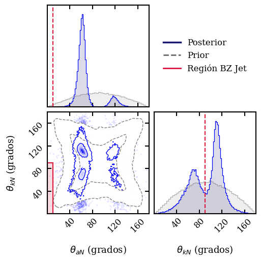
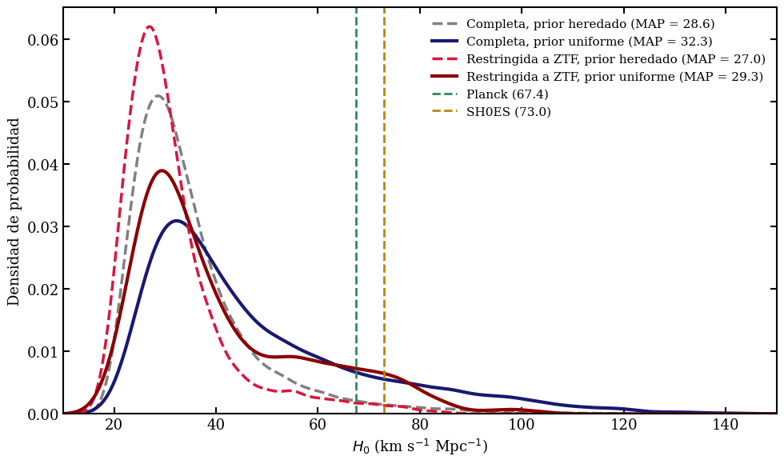

# ¿Una misma fuente para una onda gravitacional y una llamarada de luz?

**Trabajo de Fin de Grado en Física** · Universidade de Santiago de Compostela · Curso 2025-26
**Título:** *Aplicación de medidas de retroceso gravitacional y espín a observaciones multimensajero de fusiones de agujeros negros*
**Autor:** David Otero Fernández · **Tutor:** Juan Calderón Bustillo (IGFAE)

📄 Memoria completa: [`docs/TFG_David_Otero_Fernandez.pdf`](docs/TFG_David_Otero_Fernandez.pdf)

---

## De qué va (sin jerga)

En mayo de 2019 los detectores LIGO y Virgo registraron **GW190521**: las ondas gravitacionales de la fusión de dos agujeros negros, la más masiva observada hasta entonces. Unas semanas después, un telescopio óptico (ZTF) registró una **llamarada de luz**, **ZTF19abanrhr**, en una zona del cielo compatible con la señal. Dos agujeros negros que se fusionan no deberían emitir luz por sí solos, pero si estuvieran rodeados de gas podrían hacerlo. **¿Es la llamarada la luz de esa fusión, o es una casualidad?**

Este trabajo responde con **inferencia bayesiana**: se compara, para cada hipótesis, cuánta probabilidad le asigna el análisis de la señal gravitacional **antes** y **después** de mirar los datos. La novedad respecto a estudios previos, que solo comprueban si coinciden las posiciones en el cielo, es que además se contrasta **la física del mecanismo que produciría la luz** (Blandford-Znajek): exige que el agujero negro final gire y se mueva en direcciones concretas respecto a nosotros, y eso también se mide en la señal gravitacional.

## Qué se calcula y qué sale

| Pregunta | Cuaderno | Resultado |
|---|---|---|
| ¿Coinciden la posición en el cielo y la distancia? | [`01`](notebooks/01_localizacion_y_distancia.ipynb) | Los datos hacen la posición de ZTF **más probable** que antes de medir (factor de Bayes ≈ 25–35 en el cielo y ≈ 3 en la distancia). |
| ¿Es compatible la dirección del giro y del retroceso del agujero negro final con la emisión Blandford-Znajek? | [`02`](notebooks/02_kick_y_espin.ipynb) | **No**: la condición sobre el eje de giro (< 10° respecto a la línea de visión) queda muy desfavorecida (factor ≈ 0,03). |
| ¿Sale un valor razonable de la constante de Hubble si se asocia la llamarada con la fusión? | [`03`](notebooks/03_constante_de_hubble.ipynb) | $H_0$ más probable ≈ 27–32 km/s/Mpc, menos de la mitad del valor aceptado (67–73). |
| Conclusión conjunta | memoria, secc. 5 | Las probabilidades relativas favorecen la **coincidencia aleatoria** frente a la fuente común (en la memoria, ≈ 15 veces). |

<p align="center">
  
  
</p>

*Izquierda: ángulos del giro (θ_aN) y del retroceso (θ_kN) del agujero negro final; la región rosa es la que exige el mecanismo de emisión y casi no contiene probabilidad. Derecha: constante de Hubble que resultaría de asociar la llamarada con la fusión.*

## Método en cuatro ideas

1. **Prior y posterior.** El *prior* es lo que se sabe antes de medir; el *posterior*, después. Se dispone de ambos en forma de muestras (nubes de puntos).
2. **Ratio de Savage-Dickey.** El factor de Bayes de «la fuente está exactamente en este punto» frente a «puede estar en cualquier sitio» es el cociente posterior/prior evaluado en ese punto. Para hipótesis del tipo «el ángulo es menor que 10°» se usa su extensión a rangos.
3. **Método de la caja.** Con muestras no se puede evaluar una densidad en un punto: se cuenta qué fracción de las muestras cae en una pequeña caja centrada en él. El tamaño de la caja condiciona el resultado.
4. **Bootstrap.** Se remuestrean los datos 100 veces para medir la incertidumbre y se busca el tamaño de caja donde el resultado se estabiliza (*plateau*).

## Reproducibilidad y diferencias con la memoria

Los cuadernos recalculan todos los factores con una versión revisada y comentada del código del análisis. Casi todo coincide con la memoria; hay tres diferencias que conviene tener presentes:

| Magnitud | Memoria | Recalculado aquí | Comentario |
|---|---|---|---|
| $B_{ra}$, $B_{dec}$, $B_{d_L}$ | ≈ 5,5 · ≈ 2 · ≈ 3 | ≈ 5,5 · ≈ 2 · ≈ 3 | Coinciden. |
| $B_\Omega$ (cielo) | ≈ 25 | ≈ 30–35 | Dentro de lo que varía con el prior y la caja. |
| $B_{\Omega,d_L}$ (cielo + distancia) | ≈ 30 | **≈ 90–110** | Con las cajas de la memoria (0,15–0,20 rad y 150–200 Mpc) y el prior exacto. No hay *plateau* en 3D: el cociente decrece al aumentar la caja y solo baja a ≈ 30 con cajas de ≈ 0,45 rad / 450 Mpc. El orden de magnitud también es el esperado de $B_\Omega\cdot B_{d_L}\approx 30\times 3$. Detalles en el cuaderno 01. |
| $B_{\theta_{aN}}$ | ≈ 0,03 | ≈ 0,02 | Calculado como fracción $P(\theta_{aN}<10^\circ)$ posterior/prior. Se apoya en solo 7 de 50 000 muestras. |
| $B_{\theta_{kN},\theta_{aN}}$ | ≈ 0,03 | ≈ 0,03 (0,011–0,050 con bootstrap) | Coincide; 5 muestras. |
| Odds finales | ≈ 0,069 (≈ 15 veces menos probable) | ≈ 0,19 (≈ 5 veces) | Con el $B_{\Omega,d_L}$ recalculado. |

**La conclusión cualitativa no cambia**: con cualquiera de los dos valores, la hipótesis de fuente común mediante Blandford-Znajek queda desfavorecida; lo que cambia es *cuánto*. Las diferencias están discutidas en los cuadernos.

Otro detalle metodológico: el bootstrap de las cajas 2D y 3D remuestrea las coordenadas de cada muestra **juntas** (mismos índices), para no destruir sus correlaciones.

## Estructura del repositorio

```
├── notebooks/
│   ├── 01_localizacion_y_distancia.ipynb   Factores de Bayes de ra, dec, distancia y combinaciones 2D/3D
│   ├── 02_kick_y_espin.ipynb               Ángulos del giro y del retroceso; combinación y odds finales
│   └── 03_constante_de_hubble.ipynb        H0 a partir de la distancia y el redshift de la galaxia anfitriona
├── src/tfg_bayes.py                        Método de la caja, bootstrap, priors y estilo de gráficas
├── data/                                   Muestras reducidas (≈ 4,5 MB) + README con su procedencia
├── scripts/prepare_data.py                 Cómo se generan los datos reducidos a partir de los originales
├── results/b_sky_distance.json             Resultado 3D que reutiliza el cuaderno 02
└── docs/                                   Memoria del TFG y figuras del README
```

## Cómo ejecutarlo

Requiere Python ≥ 3.10.

```bash
pip install -r requirements.txt
jupyter lab notebooks/
```

Ejecuta primero el cuaderno 01 (genera `results/b_sky_distance.json`, que usa el 02). Los datos necesarios ya están en `data/`; su procedencia y cómo regenerarlos desde los archivos públicos de LIGO-Virgo se explican en [`data/README.md`](data/README.md). Los tres cuadernos tardan unos minutos en total.

## Lo que muestra este proyecto

* Inferencia bayesiana aplicada a datos reales de ondas gravitacionales: priors y posteriors, factores de Bayes, hipótesis de rango.
* Estimación de densidades a partir de muestras (método de la caja, KDE) y cuantificación de incertidumbre con **bootstrap**.
* Manejo de cambios de variable en estadística (jacobiano, repesado de muestras para cambiar el prior).
* Python científico: `NumPy`, `SciPy`, `pandas`, `Matplotlib`, `corner`, `Astropy`.
* Verificación independiente de resultados y documentación honesta de las diferencias.

## Créditos

* **Planteamiento del análisis:** Juan Calderón Bustillo (tutor). **Implementación, cálculos y memoria:** David Otero Fernández.
* **Datos:** muestras públicas de la colaboración LIGO-Virgo para GW190521 ([LIGO DCC P2000158](https://dcc.ligo.org/LIGO-P2000158/public)); R. Abbott et al., *GW190521: A Binary Black Hole Merger with a Total Mass of 150 M⊙*, [Phys. Rev. Lett. 125, 101102 (2020)](https://doi.org/10.1103/PhysRevLett.125.101102). Muestras del remanente (kick y espín) facilitadas por el tutor.

## Licencia

El código se publica bajo licencia MIT (ver [`LICENSE`](LICENSE)). La memoria y sus figuras son obra del autor; los datos de LIGO-Virgo se rigen por las condiciones de su publicación original.
